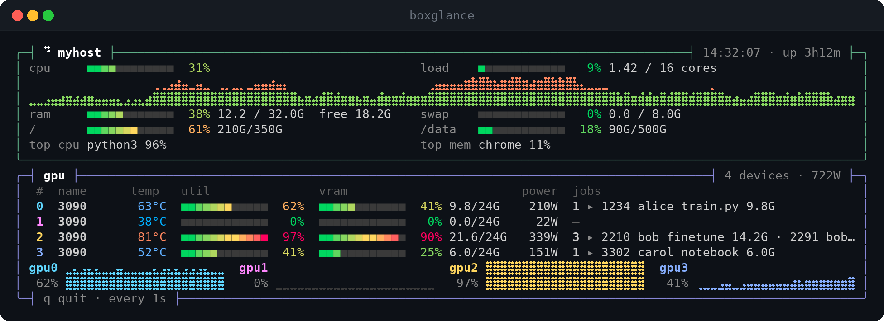

# boxglance

A single-file Bash dashboard that prints CPU, memory, disk, and GPU stats at a glance.



## Features

- CPU usage (sampled over a short interval, not an instantaneous snapshot), load average, and uptime
- RAM and swap usage
- Disk usage across one or more mount points
- Top CPU and memory consuming processes
- Per-GPU utilization, temperature, VRAM, power draw, and running compute jobs (NVIDIA only, via `nvidia-smi`)
- Rounded panels, gradient meters (green → yellow → red), and color-coded temperatures
- A `--watch` mode that redraws in place, with live braille history graphs: one for CPU, and one pane per GPU in that GPU's own color (press `q` to quit)
- A `--concise` mode that condenses everything onto a single line, for tight spaces like a status bar or a small pane
- A `--log FILE` mode that appends a CSV row of metrics on every run, and a `--stats FILE` mode that reports the min/max/avg peaks from that CSV — handy for plotting a session afterward

## Requirements

- Bash 4.2+
- Core utilities: `awk`, `ps`, `df`, `free`, `nproc`, `tput`
- Optional: `nvidia-smi` for the GPU block (skipped gracefully if not present)
- A terminal with UTF-8 and 256 colors (any modern terminal)

No non-standard dependencies and no installation step beyond making the script executable.

## Install

```sh
curl -fsSLo boxglance https://raw.githubusercontent.com/the-farshad/boxglance/main/boxglance
chmod +x boxglance
./boxglance
```

Or clone the repo and run it directly, optionally placing it on your `PATH`:

```sh
git clone https://github.com/the-farshad/boxglance.git
cd boxglance
chmod +x boxglance
sudo cp boxglance /usr/local/bin/
```

## Usage

```sh
boxglance                 # print one snapshot and exit
boxglance --watch         # live view, refreshed every 1s (q quits)
boxglance --watch 5       # refresh every 5s
boxglance --concise       # print one condensed line and exit
boxglance --watch --concise   # condensed line, refreshed every 1s
boxglance --log FILE      # append one row of metrics to FILE, for plotting later
boxglance --stats FILE    # print min/max/avg from a file written by --log
boxglance -h              # show help
```

### Concise mode

For a tmux/screen status line, a narrow pane, or anywhere the full dashboard
won't fit, `-c`/`--concise` prints a single line instead:

```
myhost 14:32:07  CPU 28%  MEM 38%  DSK 61%  GPU 62%/41% 0%/0%
```

Each `util%/vram%` pair after `GPU` is one device, in index order.

### Logging and plotting

`-l`/`--log FILE` appends one CSV row of metrics to `FILE` every time boxglance
runs, creating the header row the first time. Combine it with `--watch` to
build a time series:

```sh
boxglance --watch --log session.csv   # collect data points while you work
```

The CSV has a `timestamp` column plus `cpu_pct`, `mem_pct`, `swap_pct`, and,
if `nvidia-smi` is available, `gpu{N}_util_pct`, `gpu{N}_vram_pct`, and
`gpu{N}_temp_c` for each GPU. Load it into any plotting tool, e.g.:

```python
import pandas as pd
df = pd.read_csv("session.csv", parse_dates=["timestamp"])
df.plot(x="timestamp", y=["cpu_pct", "gpu0_util_pct"])
```

To see the peak, minimum, and average of each column without leaving the
terminal, use `--stats`:

```sh
boxglance --stats session.csv
```

```
METRIC                MIN      MAX      AVG  SAMPLES
cpu_pct               4.0     89.0     31.2      612
mem_pct               22.0     61.0     38.7      612
gpu0_util_pct          0.0     97.0     54.3      612
```

## Configuration

All configuration is via environment variables:

| Variable           | Default                                   | Description                                                        |
|--------------------|--------------------------------------------|----------------------------------------------------------------------|
| `DISKS`            | auto-detected existing common mount points | Space-separated list of mount points to report on                  |
| `BAR_W`            | `12`                                       | Width of the meters, in cells                               |
| `MAX_JOBS_PER_GPU` | `2`                                        | Max GPU jobs listed per device before collapsing the rest into `+N` |
| `CPU_SAMPLE`       | `0.10`                                     | Sampling interval, in seconds, used to measure CPU usage (in `--watch` mode, later refreshes measure since the previous one)             |

Example:

```sh
DISKS="/ /mnt/data /mnt/backup" BAR_W=20 ./boxglance
```

## License

GNU General Public License v3.0 — see [LICENSE](LICENSE).
